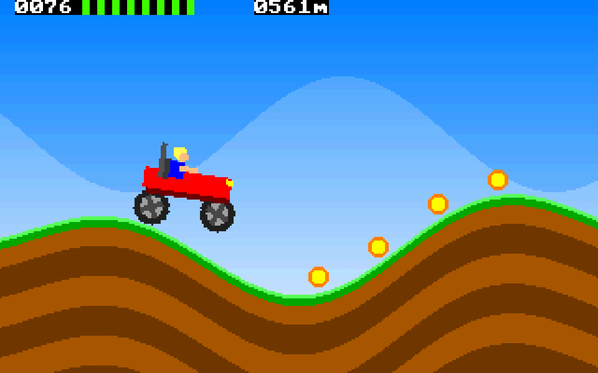

# hill climb in 1024 bytes

Hill Climb Racing in two boot sectors. Right arrow is gas, left is brake, space restarts.
Grab the red cans before the fuel runs out and don't land on your head. The hills get steeper the further you go.

    nasm -f bin hill1k.asm -o hill1k.img
    qemu-system-i386 -drive format=raw,file=hill1k.img

hill.asm is the first try that fits in 512 bytes. Same car, flat sky, no driver.

    nasm -f bin hill.asm -o hill.img
    qemu-system-i386 -drive format=raw,file=hill.img
